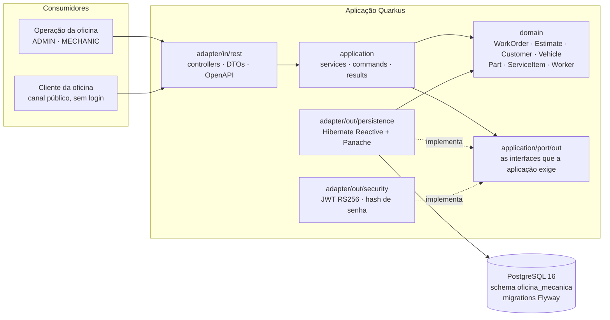
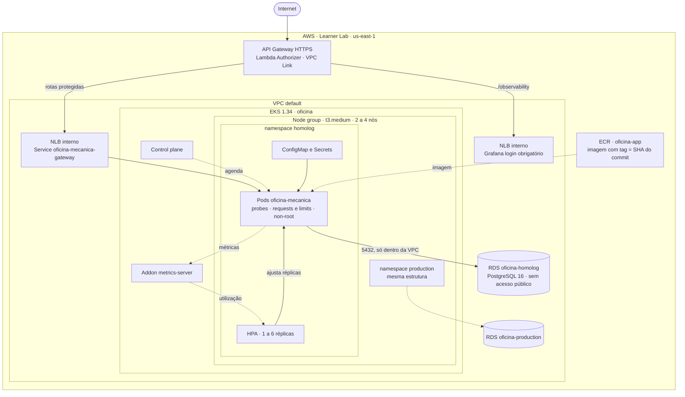
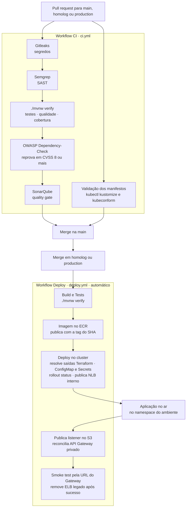

# Oficina Mecânica — Sistema Integrado de Atendimento e Execução de Serviços

## Entrega da Fase 3

- [Vídeo da Fase 3 — 13min29s](https://youtu.be/hgZPRw7hWeA).
- [Documentos, diagramas e PDF do Portal](https://github.com/15SOAT-JVGG/oficina-infra-k8s/tree/main/docs/fase3).
- [Swagger de homologação](https://dcs5hfax0e.execute-api.us-east-1.amazonaws.com/q/swagger-ui/).
- [CI de PRs](https://github.com/15SOAT-JVGG/oficina-app/actions/workflows/ci.yml) valida build, testes, qualidade e segurança.
- [Deploy](https://github.com/15SOAT-JVGG/oficina-app/actions/workflows/deploy.yml) publica a imagem e implanta em EKS nos pushes em homolog/production, com smokes pelo Gateway.
- [Seed e demonstração de HPA](https://github.com/15SOAT-JVGG/oficina-app/actions/workflows/homolog-simulation.yml): massa automática ou carga limitada; use `load_only` para demonstrar réplicas sem criar outra massa.
- [Fluxo de execução, coleção e acessos](https://github.com/15SOAT-JVGG/oficina-infra-k8s/blob/main/docs/fase3/COMECE-AQUI.md). Os acessos de runtime dependem do Learner Lab ativo; documentação e vídeo permanecem disponíveis após o encerramento.


Back-end do sistema de uma oficina mecânica — 16SOAT, Tech Challenge. Construído com
[Quarkus](https://quarkus.io/), aplica **Domain-Driven Design** sobre arquitetura hexagonal, expõe uma
**API REST documentada (Swagger)** e cobre a gestão de **ordens de serviço, clientes, veículos,
serviços, peças/insumos (com controle de estoque) e orçamentos**, além de um **canal público** para o
cliente acompanhar e autorizar o serviço.

A aplicação roda num **cluster EKS** com **Postgres gerenciado no RDS**, entrada pública pelo **API Gateway**, integração por **Load Balancer privado**,
configuração em `ConfigMap`, credenciais em `Secret`, **escalabilidade automática** por consumo de CPU
e memória, e um **caminho de entrega automatizado** que a cada push em `homolog` ou `production`
constrói, publica, implanta e verifica. A infraestrutura é código Terraform em repositórios próprios,
descritos em [Repositórios e recursos de nuvem](#repositórios-e-recursos-de-nuvem).

Este README é sobre **arquitetura, infraestrutura e operação**. A
referência da aplicação em si (funcionalidades, variáveis de configuração, autenticação, mapa de
endpoints, ciclo de vida da OS, testes e build) está em **[docs/FASE-1.md](docs/FASE-1.md)**, o
entregável da Fase 1, que continua valendo por inteiro: nada de regra de negócio ou contrato de API
mudou aqui.

---

## Sumário

- [Objetivos desta fase](#objetivos-desta-fase)
- [Arquitetura](#arquitetura)
  - [Componentes da aplicação](#componentes-da-aplicação)
  - [Infraestrutura](#infraestrutura)
  - [Fluxo de deploy](#fluxo-de-deploy)
- [Repositórios e recursos de nuvem](#repositórios-e-recursos-de-nuvem)
- [Executando localmente](#executando-localmente)
- [Implantando no cluster](#implantando-no-cluster)
- [Escalabilidade automática](#escalabilidade-automática)
- [Migrations no start da aplicação](#migrations-no-start-da-aplicação)
- [Collection das APIs](#collection-das-apis)
- [Vídeo demonstrativo](#vídeo-demonstrativo)
- [Análise estática e segurança](#análise-estática-e-segurança)
- [Documentação e decisões](#documentação-e-decisões)

---

## Objetivos desta fase

| Objetivo                   | Como é atendido                                                                                              |
| -------------------------- | ------------------------------------------------------------------------------------------------------------ |
| Rodar em Kubernetes        | Cluster EKS com `Deployment`, `Service`, `ConfigMap`, `Secret` e `HorizontalPodAutoscaler` em [`k8s/`](k8s/) |
| Infraestrutura como Código | Cluster e banco em Terraform, em repositórios próprios (ver [Repositórios](#repositórios-e-recursos-de-nuvem)) |
| Banco de dados gerenciado  | Postgres 16 no RDS, privado, alcançável apenas pelos nós do cluster                                          |
| Escalabilidade automática  | HPA de 1 a 6 réplicas por CPU e memória, alimentado pelo `metrics-server`                                    |
| Entrega automatizada       | Push em `homolog` ou `production` constrói, publica e implanta no ambiente correspondente                    |
| Reprodutibilidade          | Este README leva do ambiente provisionado à aplicação no ar                                                  |

### Stack

| Camada          | Tecnologia                                                 |
| --------------- | ---------------------------------------------------------- |
| Runtime         | Java 21 + Quarkus 3.32.3                                   |
| Persistência    | Hibernate Reactive + Panache + PostgreSQL 16               |
| Migrations      | Flyway                                                     |
| Segurança       | SmallRye JWT (RS256) + RBAC                                |
| Documentação    | SmallRye OpenAPI / Swagger UI                              |
| Observabilidade | SmallRye Health · OpenTelemetry (desabilitado por default) |
| Testes          | JUnit 5, Mockito, REST-assured, Testcontainers             |
| Container       | Docker (build multistage, runtime UBI9 non-root)           |
| Orquestração    | Kubernetes 1.34 (Amazon EKS)                               |
| IaC             | Terraform >= 1.10 nos repositórios `oficina-infra-*`       |
| CI/CD           | GitHub Actions                                             |

---

## Arquitetura

### Componentes da aplicação

O código é organizado por **bounded context** e, dentro de cada um, por camada hexagonal: o domínio
não conhece ninguém, a aplicação declara as portas de que precisa, e os adapters as implementam.



As setas cheias são dependência em tempo de compilação; as pontilhadas, implementação. Note que
nenhuma sai do `domain`: é isso que o mantém livre de framework e testável sem infraestrutura.

Contextos: `auth`, `customer`, `part`, `servicecatalog`, `vehicle`, `worker`, `workorder`, mais o
`shared` com os utilitários transversais. As regras de dependência entre camadas não são convenção de
revisão: são verificadas por testes de arquitetura a cada build.

### Infraestrutura

O cluster e o banco **não** são provisionados por este repositório: o cluster vem do
`oficina-infra-k8s` e o RDS do `oficina-infra-db`, cada um com a própria pipeline. Os dois ambientes
dividem **um cluster** e se isolam por namespace e por um RDS próprio — um cluster EKS cobra por hora,
e o Learner Lab tem crédito limitado. Ficam de fora a VPC, as subnets e as roles IAM, que a conta já
entrega prontas: é o **AWS Academy (Learner Lab)**, que não concede `iam:CreateRole`
([ADR-0001](docs/adr/0001-eks-provisionado-com-roles-do-lab-na-vpc-default.md)).



O ambiente `production` só é provisionado perto da entrega, para não gastar crédito à toa.

### Fluxo de deploy

Três workflows cobrem o caminho do código: qualidade no pull request, entrega por branch e
`pr-title-lint.yml`, que só valida o título do pull request contra Conventional Commits. A `main` é
integração e não implanta nada; a promoção é o merge em `homolog` e, depois, em `production`.



A etapa que falha interrompe a entrega. Depois do rollout, o workflow publica no S3 o listener do NLB interno,
reconcilia o API Gateway e roda o **smoke test pela URL do Gateway**. Só após sucesso o workflow remove
o Service público legado.

---

## Repositórios e recursos de nuvem

O projeto é dividido em quatro repositórios, cada um com CI/CD e deploy automático por branch
(`main` integra, `homolog` e `production` implantam):

| Repositório | O que contém | Provisiona / entrega |
| --- | --- | --- |
| `oficina-app` (este) | API Quarkus, manifestos `k8s/`, scripts de entrega | Imagem no ECR e a aplicação nos namespaces `homolog` e `production` |
| `oficina-infra-k8s` | Terraform do cluster | EKS `oficina`, node group `t3.medium` de 2 a 4 nós, ECR `oficina-app`, `metrics-server` |
| `oficina-infra-db` | Terraform do banco | RDS PostgreSQL 16, um por ambiente (`oficina-homolog`, `oficina-production`), privado |
| `oficina-lambda-auth` | Autenticação por CPF e validação de JWT (Go) | Lambdas de login e Authorizer HTTP API |

Criados fora do Terraform:

| Recurso            | Origem                                                                            |
| ------------------ | --------------------------------------------------------------------------------- |
| ELB clássico       | Materializado pelo EKS a partir do `Service type=LoadBalancer`; não está no state |
| Namespaces e acesso da pipeline | `infra/scripts/create-deploy-kubeconfig.sh`, uma vez por ambiente    |

Não criados, por restrição da conta: a VPC default, as subnets e as roles IAM já existem no Learner Lab
e são reaproveitadas.

---

## Executando localmente

### Um único comando

Pré-requisito: **Docker + Docker Compose**. Nada mais — nem Java, nem Maven, nem `.env`.

```shell
docker compose up
```

O Compose **constrói a aplicação a partir do código-fonte** (build multistage, dentro do próprio
Docker) e sobe **aplicação + PostgreSQL** já configurados. Na primeira execução o build baixa as
dependências e leva alguns minutos; nas próximas é quase instantâneo (cache).

- API: `http://localhost:8080`
- Swagger UI: `http://localhost:9000/q/swagger-ui` (interface de gerenciamento)
- Login: **`admin` / `admin123`** (ver [Autenticação JWT](docs/FASE-1.md#autenticação-jwt))

| Ação                      | Comando                      |
| ------------------------- | ---------------------------- |
| Subir em segundo plano    | `docker compose up -d`       |
| Acompanhar os logs        | `docker compose logs -f app` |
| Derrubar                  | `docker compose down`        |
| Derrubar e apagar o banco | `docker compose down -v`     |

O `.env` é **opcional**: o `docker-compose.yml` já preenche o que a aplicação precisa. Crie um `.env`
(a partir de `.env.example`) **somente** se quiser sobrescrever senhas ou nomes padrão — a tabela
completa de variáveis, com os defaults de cada ambiente, está em
[docs/FASE-1.md](docs/FASE-1.md#configuração).

O par de chaves RS256 é gerado na primeira subida pelo serviço `jwt-keys` e guardado num volume do
Docker — a imagem não carrega chave alguma.

### Dev mode (live reload)

Requer Java 21 + Maven. Sobe só o banco em container e a aplicação localmente com hot reload:

```shell
infra/scripts/generate-jwt-pair.sh    # uma única vez: cria .local-jwt/
docker compose up -d postgres
./mvnw quarkus:dev
```

- API em `http://localhost:8080` (live reload) · Dev UI em `http://localhost:8080/q/dev/`.

### Verificando por fora

O mesmo smoke test da pipeline roda contra o ambiente local:

```shell
export APP_SEED_ADMIN_PASSWORD=admin123
infra/scripts/smoke-test.sh http://localhost:8080
```

---

## Acessando o cluster

O cluster e o banco são provisionados pelos repositórios `oficina-infra-k8s` e `oficina-infra-db`
(ver [Repositórios](#repositórios-e-recursos-de-nuvem)). Com uma sessão ativa do Learner Lab e o
cluster já criado, o acesso local é:

```bash
aws eks update-kubeconfig --name oficina --region us-east-1
kubectl get nodes
kubectl top nodes     # se responder, o metrics-server está de pé e o HPA tem base de cálculo
```

As credenciais de homolog são os secrets Organization `HOMOLOG_AWS_ACCESS_KEY_ID`,
`HOMOLOG_AWS_SECRET_ACCESS_KEY` e `HOMOLOG_AWS_SESSION_TOKEN`, liberados apenas aos quatro repositórios.
Quando expirarem, renove-as no console do lab e atualize esses três secrets. Production continua usando
`AWS_ACCESS_KEY_ID`, `AWS_SECRET_ACCESS_KEY` e `AWS_SESSION_TOKEN` no Environment `production`.
`AWS_REGION` e `TF_STATE_BUCKET` já são variables da Organization; variables de Environment com o mesmo
nome têm precedência.

---

## Implantando no cluster

O cluster EKS e o banco **não** são provisionados por este repositório: o cluster vem do
`oficina-infra-k8s` e o RDS do `oficina-infra-db`, cada um com sua pipeline. Aqui ficam os manifestos
da aplicação e a entrega.

Os ambientes dividem um cluster e se isolam por **namespace** e por um **RDS próprio** cada:

| Branch       | Namespace    | Banco                       | Deploy                       |
| ------------ | ------------ | --------------------------- | ---------------------------- |
| `main`       | —            | —                           | só CI (testes, lint, scans)  |
| `homolog`    | `homolog`    | `oficina-homolog` (RDS)     | automático a cada push       |
| `production` | `production` | `oficina-production` (RDS)  | automático a cada push       |

Os manifestos vivem em [`k8s/`](k8s/), fora de `infra/`, porque é onde o enunciado da fase os exige.
A `base/` tem o que os dois ambientes dividem, e cada `overlays/<ambiente>/` escolhe o namespace e o que
varia (o host do banco):

| Objeto                                       | Arquivo                    | O que carrega                                                                                                |
| -------------------------------------------- | -------------------------- | ------------------------------------------------------------------------------------------------------------ |
| `ConfigMap` `oficina-mecanica-config`        | `k8s/base/configmap.yaml`  | Nome do banco, modo TLS, porta, issuer e expiração do JWT, caminho das chaves, usuários de seed, Swagger     |
| `ConfigMap` (patch)                          | `k8s/overlays/*/configmap-patch.yaml` | Host do RDS do ambiente                                                                           |
| `Secret` `oficina-mecanica-env`              | criado por script          | Usuário e senha do banco, senhas de seed                                                                     |
| `Secret` `oficina-mecanica-jwt`              | criado por script          | O par RS256, montado como arquivo em `/etc/jwt`                                                              |
| `Deployment` `oficina-mecanica`              | `k8s/base/deployment.yaml` | Probes, requests e limits, container non-root; o número de réplicas é do HPA                                 |
| `Service` `oficina-mecanica-gateway`         | `k8s/base/service-gateway.yaml` | `LoadBalancer` interno NLB, alcançado pela VPC Link do API Gateway                                         |
| `HorizontalPodAutoscaler` `oficina-mecanica` | `k8s/base/hpa.yaml`        | De 1 a 6 réplicas, por CPU e memória                                                                         |

Os dois `Secret` **não** estão em `k8s/` de propósito: senha do banco, credenciais de seed e chave
privada não entram no repositório.

O endereço da imagem não é versionado: ele carrega o ID da conta do Learner Lab, que muda entre
sessões. O `Deployment` traz um marcador (`oficina-mecanica`) e o deploy o troca pelo repositório `oficina-app`
do ECR e pelo SHA do commit.

### Habilitando um ambiente (uma vez)

Com o kubeconfig de administrador do cluster (`aws eks update-kubeconfig --name oficina --region us-east-1`):

```bash
# Cria o namespace, a ServiceAccount do deploy (com permissão só nele) e grava o kubeconfig dela.
infra/scripts/create-deploy-kubeconfig.sh homolog
```

Depois, no GitHub, cria-se o **Environment** `homolog` (ou `production`) deste repositório e cadastram-se
nele os secrets abaixo. Cada ambiente tem os seus: é o nome da branch que escolhe qual conjunto o deploy lê.

| Secret                                                            | De onde vem                                                              |
| ----------------------------------------------------------------- | ------------------------------------------------------------------------ |
| `KUBE_CONFIG_B64`                                                 | `infra/scripts/create-deploy-kubeconfig.sh <ambiente>`                   |
| `POSTGRES_USERNAME` / `POSTGRES_PASSWORD`                         | `db_username` e o secret `DB_PASSWORD` do `oficina-infra-db`             |
| `APP_SEED_ADMIN_PASSWORD` / `APP_SEED_MECHANIC_PASSWORD`          | Escolhidas pelo operador; são as credenciais de acesso à API             |
| `JWT_PRIVATE_KEY_B64` / `JWT_PUBLIC_KEY_B64`                      | `infra/scripts/generate-jwt-pair.sh`                                     |
| Variable `JWT_ISSUER`                                             | Issuer compartilhado; default `oficina-api`                              |
| Variables `AWS_REGION` / `TF_STATE_BUCKET`                        | Região e bucket de states e contratos                                    |
| Variable `INFRA_RECONCILE_SHA`                                    | SHA completo da revisão publicada de `oficina-infra-k8s` com `reconcile.yml` |
| `MAIL_USERNAME` / `MAIL_PASSWORD`                                 | Opcionais; sem elas o e-mail só sai se o mailer estiver em modo simulado |

`AWS_ACCESS_KEY_ID`, `AWS_SECRET_ACCESS_KEY` e `AWS_SESSION_TOKEN` são secrets do Environment, renovados
a cada sessão do lab (cerca de quatro horas). Jobs separados os usam para publicar a imagem, resolver
outputs e gravar o contrato upstream.
Depois de publicar `reconcile.yml` em `oficina-infra-k8s`, substitua `@main` pelo SHA completo no campo
`uses:` do deploy e configure o mesmo SHA em `INFRA_RECONCILE_SHA`; o workflow valida e faz checkout
dessa revisão.

O par RS256 vai para os secrets em base64:

```shell
infra/scripts/generate-jwt-pair.sh /caminho/seguro/jwt
gh secret set JWT_PRIVATE_KEY_B64 --env homolog --body "$(base64 < /caminho/seguro/jwt/privateKey.pem | tr -d '\n')"
gh secret set JWT_PUBLIC_KEY_B64  --env homolog --body "$(base64 < /caminho/seguro/jwt/publicKey.pem  | tr -d '\n')"
```

Por que a chave sai do build da imagem e o que acontece se ela for regerada:
[docs/FASE-1.md](docs/FASE-1.md#chaves-jwt-rs256).

### Pelo caminho de entrega

O workflow **Workflow Deploy** (`.github/workflows/deploy.yml`) roda a cada push em `homolog` ou
`production`: testa, constrói a imagem, resolve os outputs Terraform, aplica configuração e secrets,
espera o rollout, publica o upstream e reconcilia o Gateway antes do smoke test. A promoção é o merge `main` → `homolog` → `production`. A tag da
imagem é o SHA do commit, e é ela que faz do `kubectl apply` um rollout de verdade — com `latest`, o
objeto no cluster não mudaria e nenhum pod seria substituído.

O acesso ao cluster **não usa credencial da AWS**: a sessão do Learner Lab expira em cerca de quatro
horas e o deploy ficaria vermelho por motivo alheio ao código. Ele autentica com o token de uma
`ServiceAccount` dedicada, uma por namespace, de modo que o token de homologação não alcança produção
([ADR-0002](docs/adr/0002-deploy-no-cluster-via-kubeconfig-de-serviceaccount.md)).

Os hosts do RDS e do API Gateway não são versionados nos overlays. O workflow obtém os valores dos
outputs Terraform no bucket `TF_STATE_BUCKET`, com os secrets da sessão do Learner Lab no Environment.

### Da máquina do operador

Para um deploy manual num ambiente, com o kubeconfig de administrador:

```bash
export NAMESPACE=homolog
export POSTGRES_USERNAME=... POSTGRES_PASSWORD=...
export APP_SEED_ADMIN_PASSWORD=... APP_SEED_MECHANIC_PASSWORD=...
infra/scripts/generate-jwt-pair.sh          # uma vez
infra/scripts/create-app-credentials.sh

infra/scripts/publish-image.sh              # imprime o endereço do repositório e a tag (SHA)
cd k8s/overlays/$NAMESPACE
kustomize edit set image oficina-mecanica=<repositório>:<sha>
kubectl apply -k .
kubectl rollout status deploy/oficina-mecanica -n "$NAMESPACE"

infra/scripts/smoke-test.sh                 # prova de que funcionou, de fora para dentro
```

Use o API Gateway para chamadas externas; o NLB interno não aceita tráfego direto da Internet:

```bash
GATEWAY='https://<api-gateway-homolog>'
curl --request POST --header 'Content-Type: application/json' \
  --data '{"username":"admin","password":"<senha do seed>"}' \
  "$GATEWAY/v1/auth/login"
```

Health checks e métricas usam a interface interna de gerenciamento na porta 9000. Ela não faz parte
do `Service` público: o kubelet consulta readiness/liveness por essa porta e o `ServiceMonitor`
coleta `/q/metrics`. Para inspeção manual, faça `kubectl port-forward svc/oficina-mecanica-management
-n homolog 9000:9000` e consulte `http://localhost:9000/q/metrics`. O `ClusterIP` não recebe tráfego
da Internet; o isolamento entre pods depende de NetworkPolicy efetivamente habilitada no CNI do EKS.

---

## Escalabilidade automática

A aplicação ganha réplicas quando a carga sobe e as devolve quando a carga cai, sem intervenção. Quem
decide é o `HorizontalPodAutoscaler`, que compara o consumo dos pods com os `requests` declarados no
`Deployment` — daí a exigência de declará-los.

| Ajuste   | Valor                                    |
| -------- | ---------------------------------------- |
| Réplicas | de 1 a 6                                 |
| CPU      | 60% do request de 250m                   |
| Memória  | 80% do request de 512Mi                  |
| Subida   | imediata, até 2 pods a cada 15s          |
| Descida  | 1 pod a cada 30s, após 1 min de calmaria |

A fonte das métricas é o `metrics-server`, instalado pelo `oficina-infra-k8s` como addon gerenciado do EKS.
Um cluster nasce sem ele, e sem ele o HPA lê `<unknown>` e nunca escala.

Para reproduzir a demonstração, dois terminais — um observando `kubectl get hpa,pods -w` e outro
gerando carga com `infra/scripts/load-test.sh`, uma rajada de logins (o endpoint mais caro em CPU da
API). O roteiro completo, com os números da medição de referência, está em
[`infra/README.md`](infra/README.md#escalabilidade-automática).

---

## Migrations no start da aplicação

As migrations do Flyway rodam na **inicialização da aplicação** (`quarkus.flyway.migrate-at-start:
true`), e não num `Job` do Kubernetes dedicado. A escolha é deliberada:

- **O rollout já é o ponto de sincronização.** Um pod só passa a readiness depois de migrar o banco,
  então `kubectl rollout status` — o passo que a pipeline já executa e no qual já espera — é
  exatamente a garantia de que o schema está na frente do tráfego. Um `Job` separado exigiria um
  segundo ponto de espera para provar a mesma coisa.
- **Não há corrida no primeiro deploy.** O HPA parte de `minReplicas: 1`, então o primeiro rollout
  converge com uma única instância migrando contra um banco vazio.
- **Os deploys seguintes são cobertos pelo lock do Flyway.** A tabela de histórico é travada durante a
  migração, de modo que réplicas simultâneas não aplicam o mesmo script duas vezes: as demais esperam
  e seguem.
- **Custo em prazo.** A alternativa do `Job` foi considerada e rejeitada pelo custo de implantá-la e
  observá-la dentro do prazo da fase, sem benefício em cima das três razões acima.

O trade-off aceito: uma migration longa atrasa a readiness do pod, e uma migration incompatível com a
imagem anterior quebraria um rollout com réplicas coexistindo. Ambos são conhecidos e toleráveis no
tamanho atual do schema.

É também assim que o requisito de "deploy do banco de dados" é atendido: o RDS nasce no workflow de
provisionamento e o schema é aplicado pelo Flyway no de entrega
([ADR-0003](docs/adr/0003-pipeline-dividida-entre-provisionamento-e-entrega.md)).

---

## Collection das APIs

**[`postman/Oficina-Mecanica-E2E.postman_collection.json`](postman/Oficina-Mecanica-E2E.postman_collection.json)**
— 103 requisições em 10 pastas, em ordem executável (auth → CRUDs → ciclo completo da OS → canal do
cliente → segurança), cobrindo tanto o caminho de sucesso quanto os erros de RBAC e validação. É
auto-contida: gera tokens, CPFs e placas válidos dinamicamente. Os links assinados que o cliente
recebe por e-mail são a única parte que exige um passo manual. Instruções de uso em
[postman/README.md](postman/README.md).

Aponte a variável `base_url` para o ambiente que quer exercitar — `http://localhost:8080` no local, ou
o hostname do ELB no cluster:

```shell
kubectl get svc oficina-mecanica -o jsonpath='{.status.loadBalancer.ingress[0].hostname}'
```

Newman via Docker, contra o ambiente do Compose no ar — o container entra na rede do Compose e
alcança a aplicação pelo nome do container, porque `localhost` dentro dele não é o host:

```shell
docker run --rm --network=tech-challenge_oficina_mecanica_net \
  -v "$(pwd)/postman:/etc/newman" -t postman/newman:latest \
  run /etc/newman/Oficina-Mecanica-E2E.postman_collection.json \
  --env-var base_url=http://srv-oficina-mecanica:8080
```

---

## Vídeo demonstrativo

**Repositório público:** https://github.com/15SOAT-JVGG/tech-challenge-fase-1

**Link do vídeo:** https://youtu.be/NRhdTWcQsj4

O vídeo demonstra o provisionamento da infraestrutura, a pipeline de CI/CD executando, o deploy no
cluster, o consumo das APIs contra o ambiente implantado e a escalabilidade automática sob carga.

---

## Análise estática e segurança

`./mvnw verify` é o gate local: Spotless, Checkstyle, PMD, SpotBugs e o mínimo de cobertura do JaCoCo
(ver [Testes](docs/FASE-1.md#testes-automatizados-e-cobertura)).

A esteira de CI (`.github/workflows/ci.yml`) adiciona, a cada pull request: **Gitleaks** (segredos),
**Semgrep** (SAST), **OWASP Dependency-Check** (SCA, reprovando em CVSS >= 8), **SonarQube** (quality
gate) e a **validação dos manifestos** — `kubectl kustomize` e `kubeconform -strict` nos
overlays de `k8s/`. O Terraform é validado nos próprios repositórios `oficina-infra-*`. O resultado consolidado está em
[docs/RELATORIO-VULNERABILIDADES.md](docs/RELATORIO-VULNERABILIDADES.md), e o relatório bruto de
dependências em `dependency-check-report.zip`.

Postura do ambiente implantado: container **non-root** sem escalonamento de privilégio e com todas as
capabilities removidas; banco **sem acesso público**, alcançável apenas pelo security group dos nós;
TLS obrigatório na conexão com o RDS; senha do banco fornecida por secret e nunca versionada;
nenhuma chave privada na imagem ou no repositório.

> Em produção, defina `SWAGGER_UI_ENABLED=false`.

---

## Documentação e decisões

| Documento                                                                       | Conteúdo                                                                                                             |
| ------------------------------------------------------------------------------- | -------------------------------------------------------------------------------------------------------------------- |
| [docs/FASE-1.md](docs/FASE-1.md)                                                | A aplicação: funcionalidades, configuração, autenticação JWT, mapa de endpoints, ciclo de vida da OS, testes e build |
| [`infra/README.md`](infra/README.md)                                            | Runbook de entrega e operação: ambientes, segredos, deploy, smoke test e demonstração do HPA    |
| [ADR-0001](docs/adr/0001-eks-provisionado-com-roles-do-lab-na-vpc-default.md)   | Por que o EKS usa recursos Terraform diretos e a VPC default (parcialmente substituído pelo ADR-0007)                                        |
| [ADR-0002](docs/adr/0002-deploy-no-cluster-via-kubeconfig-de-serviceaccount.md) | Por que o deploy autentica por `ServiceAccount` e não por credencial da AWS                                          |
| [ADR-0003](docs/adr/0003-pipeline-dividida-entre-provisionamento-e-entrega.md)  | Por que provisionamento e entrega eram workflows separados (substituído pelo ADR-0007)                                                            |
| [ADR-0007](docs/adr/0007-quatro-repositorios-com-deploy-por-branch-e-um-cluster-para-dois-ambientes.md) | Quatro repositórios, deploy por branch e um cluster para dois ambientes
| [WORKORDER.md](WORKORDER.md)                                                    | Fluxo detalhado da Ordem de Serviço                                                                                  |
| [docs/MODELO-RELACIONAL.md](docs/MODELO-RELACIONAL.md)                          | Modelo relacional do schema `oficina_mecanica`                                                                       |
| [docs/RELATORIO-VULNERABILIDADES.md](docs/RELATORIO-VULNERABILIDADES.md)        | Relatório de segurança consolidado                                                                                   |
| [postman/README.md](postman/README.md)                                          | Uso da collection E2E                                                                                                |
| [AGENTS.md](AGENTS.md)                                                          | Convenções de arquitetura, DDD, clean code e testes do repositório                                                   |

**Event Storming, Bounded Contexts, Linguagem Ubíqua e Modelo de Dados:** board no
[Miro](https://miro.com/app/board/uXjVHbbU2eE=/?share_link_id=577612273301).
