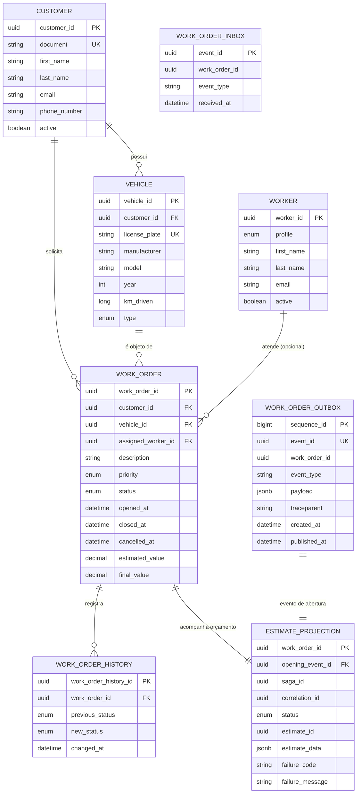

# Modelo Relacional — OS

Modelo atual do serviço OS no schema `oficina_mecanica`. O catálogo não pertence mais a este
serviço: a migration `V5__remove_local_catalog.sql` remove `parts` e `service_item` e as FKs que os
referenciavam. IDs presentes nas antigas tabelas `estimate_item` e `work_order_service` são mantidos
como histórico, sem FK nem leitura pela aplicação.

## Diagrama ER

`work_order_outbox`, `work_order_estimate_projection` e `work_order_inbox` são criadas pela
migration V4. A outbox guarda `workOrderId` sem FK para a OS, pois o Flyway executa antes da criação
da tabela Hibernate em um banco vazio. A aplicação grava a OS, a projeção e o evento dentro da mesma
transação reativa.

`estimate_item` e `work_order_service` são tabelas históricas que podem existir após a V5. A migration
remove suas FKs para as tabelas do catálogo e mantém os dados legados; não há entidades, repositórios
ou endpoints OS para essas tabelas. A projeção do orçamento guarda o payload de Billing em JSONB e
não consulta o banco do Billing.

## Enums

| Enum | Valores |
|---|---|
| `DocumentType` | CPF, CNPJ |
| `VehicleType` | CAR, MOTORCYCLE |
| `WorkerProfile` | MECHANIC, ATTENDANT |
| `WorkOrderPriority` | LOW, MEDIUM, HIGH, URGENT |
| `WorkOrderStatus` | RECEIVED, DIAGNOSIS, WAITING_APPROVAL, IN_PROGRESS, COMPLETED, DELIVERED |
| Projeção de orçamento | `AGUARDANDO`, `CRIADO`, `FALHOU`; sem solicitação inicial o status fica nulo |

O diagrama representa relações garantidas por FK ou pela transação de escrita. `work_order_id` da
outbox e `work_order_id` da inbox são metadados da integração, sem FK entre bounded contexts.
