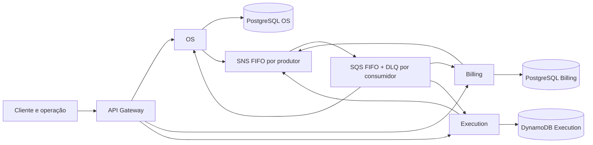

# Fronteiras e Saga da Fase 4

**Estado:** decisão para a Fase 4; implementação progressiva, não uma descrição do que já está em produção. Base: [spec #106](https://github.com/15SOAT-JVGG/oficina-app/issues/106) e correção na [#93](https://github.com/15SOAT-JVGG/oficina-app/issues/93). Esta decisão complementa e substitui parcialmente os ADRs [0004](0004-ciclo-canonico-da-ordem-de-servico.md), [0005](0005-reserva-de-estoque-e-decisao-do-cliente-por-link-assinado.md) e [0007](0007-quatro-repositorios-com-deploy-por-branch-e-um-cluster-para-dois-ambientes.md) para a Fase 4; eles registram o comportamento e as decisões anteriores.

## Propriedade e comunicação

| Dono | Responsabilidades | Persistência alvo |
| --- | --- | --- |
| OS (`oficina-app`) | OS, histórico, acompanhamento, clientes, veículos, equipe, autenticação ADMIN/MECHANIC e projeção do andamento | PostgreSQL próprio |
| Billing (`oficina-billing`) | Catálogo e preços, orçamento, decisão, cobrança e pagamento | PostgreSQL próprio |
| Execution (`oficina-execution`) | Estoque, reserva, fila de execução, mão de obra e conclusão | DynamoDB próprio |

Cada serviço escreve apenas os próprios dados; não há joins ou credenciais de banco entre serviços. OS e Billing usam transação local com outbox no PostgreSQL. Execution grava estado e outbox juntos com `TransactWriteItems`. Cada consumidor deduplica por `eventId` em inbox e confirma a mensagem somente após o commit local. Não se confunde a deduplicação FIFO de cinco minutos com idempotência persistente.

A Saga é **coreografada**: os donos reagem a fatos, persistem seus efeitos e publicam resultados; o OS mantém a projeção, sem coordenador global. Cada produtor possui um tópico SNS FIFO e cada consumidor uma fila SQS FIFO com filtro por tipo de evento; `MessageGroupId` é o `workOrderId`. A ordenação é por grupo e fila, não global entre filas. Se o Lab não permitir SNS, a alternativa prevista é publicação direta nas filas dos consumidores. A viabilidade de SNS, SQS, DynamoDB e da identidade dos pods depende da validação do Lab na [infra-k8s#51](https://github.com/15SOAT-JVGG/oficina-infra-k8s/issues/51); o desenho não atesta que estejam provisionados.

## Fluxo, contratos e compensações

| Entrada ou fato | Dono e ação | Resultado ou compensação |
| --- | --- | --- |
| Abrir OS com solicitação inicial | OS cria a OS e publica `OS aberta`; Billing cria orçamento pendente com preços copiados | Billing publica orçamento criado ou falha; OS atualiza a projeção |
| Enviar orçamento após diagnóstico | OS aceita o pedido; Execution reserva as peças | Sucesso publica peças reservadas; falta de peça leva Billing a cancelar o orçamento e OS permanece em `DIAGNOSIS` |
| Decisão do cliente | Billing registra uma decisão única e publica aprovação ou recusa | Aprovação enfileira execução; recusa faz Execution liberar a reserva e OS cancelar após confirmação |
| Prazo de decisão vence | Worker do Billing detecta o prazo persistido e publica expiração | Execution libera reserva e OS cancela após confirmação; TTL do DynamoDB não é timer |
| Execução concluída | Execution publica conclusão e valor final; OS passa a `COMPLETED` | Billing emite cobrança; pagamento confirmado libera entrega |
| Falha técnica | Dono da etapa tenta compensação com backoff | Falha persistente permanece visível e alertada; a partir de `IN_PROGRESS`, OS vai para revisão manual em vez de cancelar trabalho já iniciado |

Criar ou enviar orçamento para reserva torna-se assíncrono: a operação indicada na #110 responde `202`, e a falta de estoque deixa de ser o `422 INSUFFICIENT_PART_STOCK` síncrono do monólito. A entrega antes da confirmação de pagamento responde `422` com código novo. O Gateway preserva os caminhos públicos e encaminha catálogo/orçamento/decisão/cobrança ao Billing, estoque/execução ao Execution e as demais rotas ao OS. Essas mudanças de contrato devem constar no OpenAPI das respectivas entregas, sem afirmar que já estejam disponíveis.

A ordem mantém `RECEIVED`, `DIAGNOSIS`, `WAITING_APPROVAL`, `IN_PROGRESS`, `COMPLETED` e `DELIVERED`. Cancelamento antes da execução registra motivo de recusa, expiração ou falha; uma falha depois do início exige revisão manual. A confirmação de pagamento é pré-condição da entrega normal. Decisão por link mantém assinatura RS256 e registro de uso único; sua propriedade passa ao Billing.

## Repositórios, entrega e limites

Os serviços OS, Billing e Execution têm repositórios, pipelines e deploys independentes. A infraestrutura compartilhada permanece em `oficina-infra-k8s`, PostgreSQL em `oficina-infra-db`, autenticação de cliente em `oficina-lambda-auth` e a tabela do Execution em `oficina-infra-dynamo`; o inventário atual portanto inclui esse repositório de infraestrutura além dos seis previstos inicialmente. Um recurso pertence a um único state. O compartilhamento planejado de cluster por namespaces não comprova isolamento de credenciais; este precisa ser validado no Lab.

SonarCloud SaaS substitui o SonarQube no EKS; build, testes, cobertura de linhas de pelo menos 80% e quality gate bloqueiam as entregas conforme a implementação de cada pipeline. O BDD em CI pertence ao OS com serviços dependentes simulados; o fluxo real dos três serviços é validado em homologação. Filiais, migração de dados reais, reembolso obrigatório e interface para resolver revisão manual estão fora do escopo. O ambiente deve ser recriado com massa sintética.
